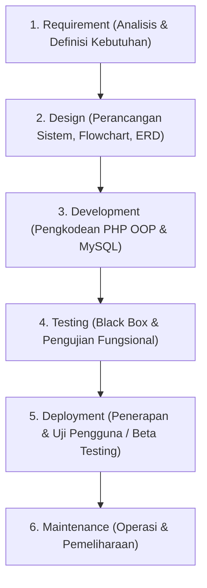
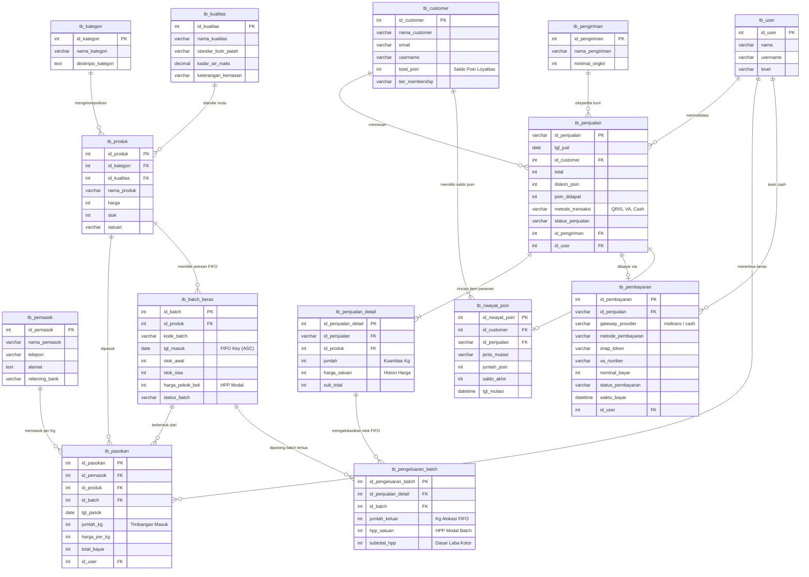

# DOKUMEN SPESIFIKASI PROYEK: SIM PENJUALAN BERAS ORGANIK BERASERA
*(Berdasarkan Analisis Lengkap BAB 1 SKRIPSI)*

---

## 1. Identitas & Latar Belakang Proyek
* **Judul Proyek**: Rancang Bangun Sistem Informasi Penjualan Beras Organik Berasera Berbasis Web
* **Mitra / Objek Penelitian**: Perkumpulan Kelompok Tani (Poktan) Gapsera Sejahtera Mandiri
* **Referensi Sumber**: Skripsi S1 Ilmu Komputer, Fakultas Ilmu Komputer, Universitas Muhammadiyah Metro (Reyfaldi Ahmad Agnanda, NPM 20430092, Tahun 2024)
* **Latar Belakang Masalah**: 
  * Berdasarkan rujukan penelitian sebelumnya (Pujiarti dkk., 2019), terdapat permasalahan pada pencatatan dan pengelolaan transaksi penjualan beras di Poktan Gapsera Sejahtera Mandiri.
  * Dibutuhkan sistem informasi penjualan beras organik berbasis website (*Berasera*) untuk mempermudah transaksi antara pembeli, bendahara, dan ketua, serta menyediakan rekapitulasi data penjualan secara otomatis.

---

## 2. Rumusan & Tujuan Penelitian / Proyek
* **Rumusan Masalah**: 
  > *"Bagaimana Rancang Bangun Sistem Informasi Penjualan Beras Organik Berasera Berbasis Web?"*
* **Tujuan Proyek**: 
  Merancang dan membangun sistem informasi penjualan beras organik Berasera berbasis web yang mempermudah proses transaksi, pengelolaan data produk, dan pembuatan laporan penjualan.
* **Manfaat Sistem**:
  1. **Bagi Mitra (Poktan Gapsera Sejahtera Mandiri)**: Mempermudah pegawai, bendahara, ketua, dan pembeli dalam bertransaksi serta pengelolaan data penjualan secara rapi.
  2. **Bagi Akademik**: Menjadi referensi karya ilmiah dalam bidang rekayasa perangkat lunak dan sistem basis data.
  3. **Bagi Pengembang/Mahasiswa**: Penerapan praktis pemodelan basis data, OOP, dan pengembangan aplikasi web.

---

## 3. Batasan Masalah & Ruang Lingkup Sistem

### A. Hak Akses (User Roles) & Fungsionalitas
Sistem membedakan hak akses ke dalam **3 Pengguna Utama**:

| Role / Pengguna | Hak Akses & Tugas di Sistem |
| :--- | :--- |
| **Ketua** | - Menginput dan mengelola data master produk (foto produk, nama produk, harga, jenis beras).<br>- Memproses dan memantau transaksi penjualan.<br>- Melihat dan mencetak output **Laporan Penjualan**. |
| **Bendahara** | - Menginput dan mengelola data master produk (foto produk, nama produk, harga, jenis beras).<br>- Memproses transaksi penjualan dan memvalidasi pembayaran.<br>- Mengelola dan mencetak output **Laporan Penjualan**. |
| **Pembeli (Customer)** | - Melihat katalog produk beras organik Berasera.<br>- Melakukan pembelian / order beras melalui website. |

### B. Lingkungan Teknologi & Arsitektur
* **Framework Backend**: **Laravel 12 (Versi Terbaru)** dengan arsitektur MVC (*Model-View-Controller*) & Eloquent ORM.
* **Basis Data**: **MySQL** (`db_penjualan_berasera` di XAMPP / MariaDB).
* **Payment Gateway**: **Midtrans Snap API** (paket resmi `midtrans/midtrans-php` terpasang).
* **Web Server Lokal**: XAMPP (Apache & MySQL).
* **Kode Editor**: Visual Studio Code.
* **Browser Pengujian**: Google Chrome.

---

## 4. Metodologi Pengembangan Sistem (SDLC)
Menggunakan **Model Waterfall** (Ian Sommerville 2011) yang terdiri dari 6 tahapan terstruktur:



1. **Requirement**: Pengumpulan data kebutuhan sistem melalui wawancara dengan Pemilik & Staff Gapsera Sejahtera Mandiri, observasi proses penjualan langsung, dan dokumentasi profil mitra.
2. **Design**: Perancangan software menggunakan **Flowchart**, **Mind Map**, dan **Entity Relationship Diagram (ERD)** basis data.
3. **Development**: Implementasi desain ke dalam baris kode PHP OOP modular dan pembuatan skema database MySQL.
4. **Testing**: Pengujian unit dan integrasi fungsi menggunakan metode **Black Box Testing**.
5. **Deployment**: Uji coba sistem langsung ke pengguna (*Beta Testing*).
6. **Maintenance**: Pemeliharaan sistem serta penanganan bug/perbaikan berkelanjutan.

---

## 5. Rencana Entitas & Data Inti (Persiapan Basis Data Lanjut)
Berdasarkan batasan masalah di Bab 1, tabel-tabel utama yang wajib dirancang meliputi:
1. `users` (id_user, nama, username, password, role: `ketua`, `bendahara`, `pembeli`, no_hp, alamat)
2. `kategori_beras` / `jenis_beras` (id_jenis, nama_jenis: misal Beras Merah, Beras Hitam, Beras Mentik Wangi Organik, dll.)
3. `produk` (id_produk, id_jenis, nama_produk, harga, stok, deskripsi, foto_produk)
4. `transaksi` / `pesanan` (id_transaksi, id_pembeli, tanggal, total_harga, status_pesanan, bukti_pembayaran, id_petugas)
5. `detail_transaksi` (id_detail, id_transaksi, id_produk, jumlah, harga_satuan, subtotal)
6. **Fitur Basis Data Lanjut pendukung**:
   * *View*: View Rekap Penjualan Bulanan / Harian, View Detail Transaksi Lengkap.
   * *Stored Procedure*: Prosedur checkout pesanan otomatis.
   * *Trigger*: Pengurangan stok beras otomatis saat transaksi berhasil diverifikasi.

---

## 6. Standarisasi Penamaan Primary Key & Foreign Key
Sesuai kaidah perancangan basis data, **setiap tabel WAJIB mendefinisikan Primary Key secara eksplisit** dengan format penamaan berbasis nama entitas/tabel (`id_<nama_tabel>`):

| No | Nama Tabel | Primary Key (PK) | Foreign Key (FK) & Relasi | Keterangan Entitas |
| :---: | :--- | :--- | :--- | :--- |
| 1 | `tb_kategori` | `id_kategori` | - | Kategori jenis beras (organik hitam, merah, dll.) |
| 2 | `tb_produk` | `id_produk` | `id_kategori` $\rightarrow$ `tb_kategori(id_kategori)` | Data produk beras, harga, dan stok |
| 3 | `tb_customer` | `id_customer` | - | Data akun pembeli / pelanggan |
| 4 | `tb_pengiriman` | `id_pengiriman` | - | Data kurir/ekspedisi dan ongkos kirim minimal |
| 5 | `tb_user` | `id_user` | - | Data pengurus (Ketua & Bendahara Gapsera) |
| 6 | `tb_penjualan` | `id_penjualan` | • `id_customer` $\rightarrow$ `tb_customer(id_customer)`<br>• `id_pengiriman` $\rightarrow$ `tb_pengiriman(id_pengiriman)`<br>• `id_user` $\rightarrow$ `tb_user(id_user)` *(Petugas validasi)* | Header transaksi pesanan beras |
| 7 | `tb_penjualan_detail` | `id_penjualan_detail` | • `id_penjualan` $\rightarrow$ `tb_penjualan(id_penjualan)`<br>• `id_produk` $\rightarrow$ `tb_produk(id_produk)` | Item rincian barang yang dibeli + harga riil saat transaksi |
| 8 | `tb_pembayaran` | `id_pembayaran` | • `id_penjualan` $\rightarrow$ `tb_penjualan(id_penjualan)` | Integrasi **Payment Gateway** (Snap token, VA number, QRIS, status transaksi settlement/pending via webhook otomatis) |

---

## 7. Evaluasi Normalisasi (1NF, 2NF, 3NF)
* **1NF (First Normal Form)**: **Lolos**. Setiap kolom menyimpan nilai atomik (tunggal), memiliki PK unik, dan rincian transaksi berulang dipisah ke tabel detail.
* **2NF (Second Normal Form)**: **Lolos**. Seluruh tabel memakai Single Primary Key (`id_...`), sehingga tidak ada ketergantungan fungsional sebagian (*partial dependency*).
* **3NF (Third Normal Form)**: **Perbaikan Disempurnakan**.
  * Atribut kalkulasi/turunan `sub_total` dan `total` ditangani secara tepat (dihitung dinamis via **SQL View** atau dipelihara integritasnya melalui **Database Trigger**).
  * Menambahkan `harga_satuan` pada `tb_penjualan_detail` agar rekam jejak harga historis tidak rusak jika harga di `tb_produk` berubah.
  * Menghubungkan `tb_user` ke `tb_penjualan` / `tb_pembayaran` via `id_user` agar relasi pengurus yang memproses penjualan tercatat dengan jelas.

---

## 8. Analisis Rinci Kekurangan Relasi Tabel (Gambar 26) & Solusi Perbaikannya

| No | Komponen / Tabel | Kekurangan Desain Asli (Skripsi) | Dampak Masalah | Solusi Perbaikan (Sudah Diterapkan di SQL) |
| :-: | :--- | :--- | :--- | :--- |
| **1** | **`tbuser` (Pengurus)** | **Tabel terisolasi (tidak memiliki relasi sama sekali)** ke tabel manapun. | Sistem tidak bisa mencatat siapa Ketua/Bendahara yang memvalidasi pesanan atau memverifikasi pembayaran (*Audit Trail* hilang). | Tambahkan Foreign Key `id_user` pada `tb_penjualan` dan `tb_pembayaran`. |
| **2** | **`tbproduk`** | **Tidak ada kolom `stok` beras.** | Sistem e-commerce tidak bisa mengecek ketersediaan beras, rentan *overselling* (stok habis tapi tetap bisa dibeli). | Tambahkan kolom `stok INT UNSIGNED NOT NULL DEFAULT 0` pada `tb_produk`. |
| **3** | **`tbpenjualan_detail`** | **Tidak ada kolom `harga_satuan`.** Hanya ada `jumlah` dan `sub_total`. | Jika harga beras di master `tb_produk` naik, histori harga transaksi lama hilang dan laporan keuangan berisiko korup. | Tambahkan kolom `harga_satuan INT UNSIGNED NOT NULL` untuk membekukan (*freeze*) harga saat transaksi terjadi. |
| **4** | **`tbpenjualan_detail` & `tbpenjualan`** | **Pelanggaran 3NF murni** pada kolom turunan `sub_total` dan `total`. | Nilai bisa menjadi tidak sinkron jika aplikasi salah hitung atau data diedit manual di database. | Kendalikan integritas perhitungan menggunakan **Database Trigger** atau kalkulasi dinamis via **SQL View**. |
| **5** | **`tbpembayaran`** | **Tidak ada kolom status verifikasi pembayaran.** | Bendahara tidak punya penanda apakah bukti transfer pelanggan itu valid, belum diperiksa, atau palsu/ditolak. | Tambahkan kolom `status_konfirmasi ENUM('menunggu', 'valid', 'ditolak') DEFAULT 'menunggu'`. |
| **6** | **`tbpenjualan`** | **Ukuran `VARCHAR(10)` pada `id_penjualan` terlalu sempit.** | Format kode nota seperti `PJL-20261023-0001` (17 karakter) akan terpotong (*truncated error*). | Perlebar menjadi `VARCHAR(20)` agar muat format penomoran nota transaksi modern. |
| **7** | **Integritas Relasi** | **Tidak ada pendefinisian aturan `ON DELETE` / `ON UPDATE`.** | Terjadi data yatim (*orphan records*) jika data master produk atau customer terhapus padahal memiliki riwayat transaksi. | Pasang aturan integritas referensial: `ON UPDATE CASCADE` dan `ON DELETE RESTRICT` (atau `CASCADE` untuk item detail). |
| **8** | **Basis Data Lanjut** | **Belum ada otomatisasi mutasi stok.** | Pengurangan dan penambahan stok beras masih manual via kode aplikasi, rentan *race condition*. | Buat **Trigger** `trg_kurangi_stok_produk` (saat item terjual) dan `trg_kembalikan_stok_produk` (jika pesanan dibatalkan). |

---

## 9. Diagram Relasi Tabel (Entity Relationship Diagram - ERD)



---

## 10. Alur Autentikasi Pembeli & Pembayaran Online (End-to-End Workflow)

Sesuai instruksi proyek, seluruh proses transaksi dilakukan secara **online penuh (digital payment)** dengan alur kerja berikut:

### 1. Autentikasi Pembeli (Registrasi & Login)
* **Pendaftaran Akun (`tb_customer`)**:
  * Form pendaftaran menampung: `nama_customer`, `alamat` domisili, `telepon`, `email`, `username`, dan `password` (dienkripsi aman menggunakan `password_hash()` bcrypt).
* **Login Pembeli**:
  * Pembeli masuk menggunakan `username` dan `password`.
  * Sistem membuat session aman (`$_SESSION['customer_id']`, `$_SESSION['customer_name']`).
  * Jika belum login saat menekan tombol checkout, sistem otomatis mengarahkan pembeli ke form login terlebih dahulu.

### 2. Pemesanan & Checkout Beras
* Pembeli memilih varian beras organik (Beras Merah, Hitam, atau Mentik Wangi), memilih jumlah kuantitas (Kg).
* Di halaman checkout, pembeli:
  * Memilih kurir/ekspedisi pengiriman (`tb_pengiriman`).
  * Mengisi/mengonfirmasi alamat pengiriman spesifik.
  * Sistem menghitung total: $\text{Total} = \sum(\text{Subtotal Beras}) + \text{Ongkir}$.

### 3. Eksekusi Pembayaran Online (Midtrans Snap Payment Gateway)
* Saat pembeli menekan tombol **"Bayar Sekarang Online"**:
  1. Sistem meng-generate nomor transaksi unik (misal: `PJL-20261023-0001`) di tabel `tb_penjualan` dan item di `tb_penjualan_detail`.
  2. Sistem di backend PHP OOP memanggil Midtrans Snap API menggunakan `Server Key` untuk meminta `Snap Token`.
  3. Pop-up antarmuka pembayaran Midtrans langsung muncul di layar pembeli:
     * **QRIS**: Scan langsung via GoPay, BCA Mobile, OVO, Dana, LinkAja, ShopeePay.
     * **Virtual Account Bank (VA)**: Nomor VA instan BCA, BRI, BNI, Mandiri, Permata.
     * **E-Wallet**: Direct debit GoPay / ShopeePay.
  4. Pembeli melakukan pembayaran melalui channel yang dipilih.

### 4. Otomatisasi Status & Mutasi Stok (Real-Time Webhook)
* Midtrans mengirimkan notifikasi HTTP POST (Webhook) ke endpoint sistem (`/api/midtrans-webhook.php`).
* Ketika status pembayaran bernilai `settlement` (berhasil dibayar):
  * Status di `tb_pembayaran` otomatis menjadi `settlement`.
  * **Database Trigger MySQL** `trg_update_status_penjualan_midtrans` langsung mengubah status `tb_penjualan` menjadi `diverifikasi` / `diproses`.
  * **Database Trigger MySQL** `trg_kurangi_stok_produk` memotong stok fisik beras di `tb_produk`.
  * Pembeli langsung melihat status faktur/nota berubah menjadi **"Lunas / Terverifikasi"**.
  * Ketua dan Bendahara di dashboard pengurus langsung melihat pesanan lunas siap dikemas dan dikirim.

---

## 11. Pengelompokan Jenis & Kualitas Beras Organik

Untuk memastikan standar komoditas pangan organik yang transparan bagi pembeli dan tertata rapi dalam sistem:

### A. Pengelompokan Jenis Beras Organik
1. **Beras Merah Organik**:
   * Karakteristik: Beras pecah kulit kaya serat, antioksidan antosianin, dan indeks glikemik rendah.
   * Manfaat: Cocok untuk penderita diabetes dan program diet sehat.
2. **Beras Hitam Organik**:
   * Karakteristik: Varietas beras bernutrisi tertinggi, pigmen hitam pekat alami, kaya zat besi dan vitamin E.
   * Manfaat: Mencegah penuaan dini, memelihara kesehatan jantung, dan detoksifikasi alami.
3. **Beras Mentik Wangi Organik (Beras Putih)**:
   * Karakteristik: Beras putih pulen lokal khas pegunungan dengan aroma wangi daun pandan alami tanpa zat pewangi kimia.
   * Manfaat: Alternatif sehat beras putih harian keluarga yang aman dari residu pestisida.
4. **Beras Cokelat / Pecah Kulit Organik**:
   * Karakteristik: Beras dengan lapisan aleuron utuh yang kaya vitamin B kompleks.

### B. Pengelompokan Kualitas / Standar Mutu Beras
Sistem mengklasifikasikan beras ke dalam 3 tingkatan mutu (*Quality Grade*):

| Kategori Mutu | Standar Butir Kepala | Toleransi Butir Patah (Broken) | Kadar Air Maks. | Derajat Sosoh | Kemasan & Keterangan |
| :--- | :---: | :---: | :---: | :---: | :--- |
| **Grade A (Premium)** | $\ge 95\%$ | $\le 5\%$ | $14\%$ | $100\%$ | Kemasan vakum kedap udara (*vacuum packaging*), bersih tanpa kutu & kerikil, aroma khas terjaga maksimal. |
| **Grade B (Medium Super)** | $85\% - 94\%$ | $6\% - 15\%$ | $14.5\%$ | $90\%$ | Kemasan standar berperekat rapat, butir beras seragam, layak konsumsi harian keluarga. |
| **Grade C (Standar)** | $75\% - 84\%$ | $16\% - 25\%$ | $15\%$ | $85\%$ | Kualitas ekonomis untuk kebutuhan olahan makanan / katering. |

---

## 12. Arsitektur & Mekanisme Sistem Persediaan FIFO (First In, First Out)

### A. Mengapa Beras Organik Wajib Menggunakan FIFO?
Beras organik dibudidayakan tanpa bahan kimia sintetik dan pestisida pengawet. Oleh karena itu:
* Memiliki masa simpan (*shelf-life*) alami tertentu (rentan terhadap penurunan aroma dan kutu alami jika terlalu lama di gudang).
* **Prinsip FIFO**: Beras dari **batch panen/giling yang pertama kali masuk gudang wajib menjadi beras yang pertama kali dikeluarkan/dijual kepada pembeli**.
* Mencegah stok beras lama menumpuk dan kadaluarsa di gudang.

### B. Desain Tabel Pendukung FIFO di Database
1. **Tabel Master Batch Masuk (`tb_batch_beras`)**:
   * `id_batch` (PK INT AUTO_INCREMENT)
   * `id_produk` (FK $\rightarrow$ `tb_produk`)
   * `kode_batch` (VARCHAR 30, misal: `BATCH-MRH-202610-01`)
   * `tgl_masuk` (DATE) $\rightarrow$ **Kunci Utama Pengurutan FIFO (ASC)**
   * `tgl_panen_giling` (DATE)
   * `tgl_kadaluarsa` (DATE)
   * `stok_awal` (INT) $\rightarrow$ kuantitas beras awal saat masuk gudang
   * `stok_sisa` (INT) $\rightarrow$ kuantitas yang masih tersedia (berkurang setiap transaksi)
   * `harga_pokok_beli` (INT) $\rightarrow$ HPP / modal per Kg dari kelompok tani
   * `status_batch` (ENUM: `'tersedia'`, `'habis'`)

2. **Tabel Pencatatan Alokasi Pengeluaran FIFO (`tb_pengeluaran_batch`)**:
   * `id_pengeluaran_batch` (PK INT AUTO_INCREMENT)
   * `id_penjualan_detail` (FK $\rightarrow$ `tb_penjualan_detail`)
   * `id_batch` (FK $\rightarrow$ `tb_batch_beras`)
   * `jumlah_keluar` (INT) $\rightarrow$ berapa kg yang diambil dari batch tersebut
   * `hpp_satuan` (INT) $\rightarrow$ HPP per kg saat batch tersebut dipotong
   * `subtotal_hpp` (INT) $\rightarrow$ `jumlah_keluar * hpp_satuan` (dasar kalkulasi laba kotor)

### C. Alur Kerja Algoritma FIFO saat Transaksi Penjualan
Ketika pembeli memesan beras varian $X$ sejumlah $Q$ kg:
1. Sistem mencari seluruh batch dari produk $X$ yang berstatus `stok_sisa > 0`, diurutkan dari yang paling awal masuk:
   ```sql
   SELECT * FROM tb_batch_beras 
   WHERE id_produk = :id_produk AND stok_sisa > 0 
   ORDER BY tgl_masuk ASC, id_batch ASC;
   ```
2. **Proses Pemotongan Bertahap (Iterasi FIFO)**:
   * **Kasus 1**: Jika batch tertua memiliki `stok_sisa >= Q`:
     * Potong seluruh $Q$ dari batch tersebut: `stok_sisa = stok_sisa - Q`.
     * Catat alokasi $Q$ pada `tb_pengeluaran_batch`.
     * Transaksi terpenuhi.
   * **Kasus 2**: Jika batch tertua hanya memiliki `stok_sisa < Q` (misal sisa 3 kg, padahal pesanan 5 kg):
     * Ambil habis sisa batch tersebut (3 kg): `stok_sisa = 0`, status menjadi `'habis'`.
     * Catat pengeluaran 3 kg dari batch pertama di `tb_pengeluaran_batch`.
     * Sisa kebutuhan $Q = 5 - 3 = 2$ kg dipotong dari batch berikutnya (batch terlama kedua).
     * Ulangi proses hingga seluruh kuantitas pesanan terpenuhi.

### D. Manfaat untuk Mata Kuliah "Basis Data Lanjut"
3. **Integritas Transaksi**: Didukung fitur Stored Procedure / Trigger MySQL dan Transaction Rollback (`DB::transaction`) jika stok tidak mencukupi.

---

## 13. Manajemen Pelanggan & Sistem Poin Loyalitas (Customer Loyalty Points)

Untuk meningkatkan retensi pembeli beras organik Berasera dan memberikan nilai tambah pada setiap transaksi:

### A. Mekanisme Perolehan & Penukaran Poin
1. **Perolehan Poin (Earn Points)**:
   * Setiap pembelian beras yang berhasil dibayar lunas (*status settlement Midtrans*), pembeli otomatis memperoleh poin reward.
   * **Formula**: Setiap transaksi Rp 10.000,- pembeli mendapatkan **1 Poin** (atau setara *cashback reward* 1%).
   * Poin langsung dikreditkan ke saldo akun pelanggan secara otomatis via Webhook/Trigger.
2. **Penukaran Poin (Redeem Points as Discount)**:
   * Poin yang terkumpul dapat digunakan sebagai potongan harga langsung pada saat *checkout* pesanan berikutnya.
   * **Nilai Tukar**: **1 Poin = Potongan Rp 100,-** (misal: 100 poin = diskon Rp 10.000).
   * Pembeli dapat memilih berapa jumlah poin yang ingin dipakai pada pesanan tersebut.

### B. Rancangan Struktur Data Sistem Poin
1. **Pembaruan Tabel Pelanggan (`tb_customer`)**:
   * Menambahkan kolom `total_poin INT UNSIGNED DEFAULT 0` (saldo poin aktif saat ini).
   * Menambahkan kolom `tier_membership ENUM('Silver', 'Gold', 'Platinum') DEFAULT 'Silver'`.
2. **Tabel Riwayat Mutasi Poin (`tb_riwayat_poin`)**:
   * `id_riwayat_poin` (PK INT AUTO_INCREMENT)
   * `id_customer` (FK $\rightarrow$ `tb_customer`)
   * `id_penjualan` (FK NULL $\rightarrow$ `tb_penjualan`)
   * `jenis_mutasi` (ENUM: `'masuk'`, `'keluar'`)
   * `jumlah_poin` (INT)
   * `saldo_akhir` (INT)
   * `keterangan` (VARCHAR: misal *"Reward transaksi #PJL-202610-001"* atau *"Diskon belanja"*)
   * `tgl_mutasi` (DATETIME)
3. **Pembaruan Tabel Transaksi (`tb_penjualan`)**:
   * `poin_digunakan` (INT DEFAULT 0)
   * `diskon_poin` (INT DEFAULT 0, nilai nominal potongan belanja)
   * `poin_didapat` (INT DEFAULT 0)

---

## 14. Modul Laporan Keuangan Detail (Financial Reporting System)

Untuk peran **Bendahara** dan **Ketua Gapsera Sejahtera Mandiri**, sistem menyediakan modul laporan keuangan komprehensif berbasis data transaksi dan HPP FIFO yang akurat:

### A. Jenis-Jenis Laporan Keuangan

#### 1. Laporan Laba Rugi Komprehensif (Income Statement / Profit & Loss)
* **Pendapatan Kotor (Gross Revenue)**: Total nilai penjualan beras sebelum diskon.
* **Potongan Penjualan**: Nilai diskon dari voucher / penukaran poin loyalitas.
* **Pendapatan Bersih (Net Revenue)**: Nilai riil uang yang masuk dari penjualan beras.
* **Harga Pokok Penjualan (HPP) FIFO**: Total modal beras yang dikeluarkan berdasarkan batch panen riil (`tb_pengeluaran_batch`).
* **Laba Kotor Penjualan (Gross Profit)**: $\text{Pendapatan Bersih} - \text{HPP FIFO}$.
* **Biaya Operasional**: Biaya kemasan vakum, label stiker, dan biaya kirim internal.
* **Laba Bersih Usaha (Net Profit)**.

#### 2. Laporan Arus Kas (Cash Flow Statement)
* **Arus Kas Masuk (Cash Inflow)**: Rincian penerimaan dana dari Payment Gateway Midtrans (QRIS, VA Bank, E-Wallet) yang berhasil masuk ke rekening Gapsera.
* **Arus Kas Keluar (Cash Outflow)**: Pembayaran modal beras kepada petani anggota Poktan, biaya ekspedisi, dan biaya operasional.
* **Saldo Kas Akhir Periode**.

#### 3. Laporan Kartu Stok & Nilai Persediaan Beras (Inventory Valuation)
* Menampilkan saldo persediaan beras di gudang per varietas beras (Merah, Hitam, Mentik Wangi) dan per mutu (Grade A, B, C).
* Menghitung nilai aset persediaan gudang: $\text{Total Stok Sisa (Kg)} \times \text{HPP Tiap Batch}$.

#### 4. Laporan Penjualan Per Kategori & Produk Terlaris (*Top Selling Product*)
* Analisis varietas beras organik yang paling diminati pembeli, volume penjualan (Kg), omset, dan persentase kontribusi laba.

### B. Fitur & Pengaturan Laporan
* **Filter Periode Dinamis**: Harian, Mingguan, Bulanan, Triwulan, Tahunan, atau kustom tanggal (`start_date` s/d `end_date`).
* **Format Ekspor Resmi**:
  * **Cetak PDF**: Dilengkapi kop surat resmi Poktan Gapsera Sejahtera Mandiri, nomor dokumen, dan kolom tanda tangan Bendahara & Ketua.
  * **Ekspor Excel / CSV**: Memudahkan audit data keuangan lanjutan dan arsip pembukuan.

---

## 15. Manajemen Pemasok / Petani Mitra (Perhitungan Pasokan Per Kg)

Untuk menjamin kelancaran pasokan beras organik langsung dari petani anggota kelompok tani Gapsera Sejahtera Mandiri:

### A. Aturan Bisnis Pasokan (Per Kg Calculation)
* **Satuan Standar Pasokan**: Seluruh beras yang disetorkan oleh pemasok/petani dihitung berbasis **bobot kilogram (Kg)**.
* **Harga Beli Pokok (HPP / Kg)**: Ditentukan per kilogram sesuai jenis dan kualitas beras saat panen/giling (misal: Beras Merah Rp 16.000/Kg, Beras Hitam Rp 20.000/Kg, Beras Mentik Wangi Rp 14.500/Kg).
* **Formula Pembayaran Pasokan**: 
  $$\text{Total Tagihan Pemasok} = \text{Jumlah Pasokan (Kg)} \times \text{Harga Beli Pokok per Kg}$$
* **Integrasi Otomatis dengan Sistem FIFO**:
  * Setiap penerimaan beras dari pemasok langsung dicatat sebagai **Batch Masuk Baru** di tabel `tb_batch_beras`.
  * Batch tersebut memiliki `tgl_masuk` hari penerimaan dan stok awal (Kg) yang siap dialokasikan untuk penjualan dengan antrean FIFO.

### B. Rancangan Struktur Data Pemasok
1. **Tabel Master Pemasok / Petani (`tb_pemasok`)**:
   * `id_pemasok` (PK INT AUTO_INCREMENT)
   * `nama_pemasok` (VARCHAR 100, nama petani / kelompok tani asal)
   * `telepon` (VARCHAR 25)
   * `alamat` (TEXT, lokasi lahan/desa)
   * `rekening_bank` (VARCHAR 100, bank & nomor rekening petani untuk pembayaran)
   * `status_pemasok` (ENUM: `'aktif'`, `'nonaktif'`)
2. **Tabel Pengadaan / Pasokan Beras (`tb_pasokan`)**:
   * `id_pasokan` (PK INT AUTO_INCREMENT)
   * `id_pemasok` (FK $\rightarrow$ `tb_pemasok`)
   * `id_produk` (FK $\rightarrow$ `tb_produk`)
   * `id_batch` (FK $\rightarrow$ `tb_batch_beras`, batch persediaan yang terbentuk)
   * `tgl_pasok` (DATE)
   * `jumlah_kg` (DECIMAL(10,2) / INT, bobot timbangan beras masuk)
   * `harga_per_kg` (INT UNSIGNED, tarif modal per kg)
   * `total_bayar` (INT UNSIGNED, total nilai pengadaan)
   * `status_pembayaran_petani` (ENUM: `'lunas'`, `'belum_lunas'`)
   * `id_user` (FK $\rightarrow$ `tb_user`, bendahara/petugas penerima)

---

## 16. Metode Pembayaran Terpadu (Multi-Channel Payment)

Sistem penjualan beras organik Berasera melayani berbagai skenario pembayaran modern dan konvensional:

| No | Metode Pembayaran | Mekanisme & Saluran | Verifikasi Pembayaran | Cocok Untuk |
| :-: | :--- | :--- | :--- | :--- |
| **1** | **QRIS (Quick Response Code Indonesian Standard)** | Di-generate otomatis oleh **Midtrans Snap API**. Pembeli cukup memindai QR code dari aplikasi e-wallet (GoPay, OVO, Dana, LinkAja, ShopeePay) atau m-Banking (BCA, BRI, Mandiri, BNI). | **Otomatis 100% Real-Time** melalui Webhook notifikasi Midtrans. | Pembeli mobile yang ingin transaksi cepat tanpa input nomor rekening. |
| **2** | **Virtual Account Bank (Bank Transfer)** | Di-generate nomor VA unik per transaksi oleh **Midtrans Snap API** (BCA VA, BRI VA, BNI VA, Mandiri Bill, Permata VA). | **Otomatis 100% Real-Time** saat transfer berhasil di ATM / Internet Banking / m-Banking. | Pembeli yang terbiasa transfer bank dengan batas waktu bayar (misal 24 jam). |
| **3** | **Midtrans Gateway Lainnya** | Saluran direct debit e-Wallet (GoPay, ShopeePay) serta pembayaran gerai retail (Indomaret / Alfamart). | **Otomatis Real-Time** via Webhook Midtrans. | Pembeli yang tidak memiliki rekening bank. |
| **4** | **Tunai / Cash (Direct Payment / COD)** | Pembeli membayar secara langsung dengan uang tunai saat: <br>a. Membeli langsung di gerai/gudang Poktan Gapsera Sejahtera Mandiri di Kota Metro.<br>b. Layanan COD (Bayar di Tempat) untuk pengiriman kurir lokal internal. | **Manual Approval**: Petugas / Bendahara memeriksa uang fisik lalu menekan tombol konfirmasi *"Terima Uang Cash"* di dashboard pengurus. | Pelanggan lokal, warga sekitar, atau pembeli tradisional. |

### C. Alur Status Transaksi Berdasarkan Metode Pembayaran:
* **Jalur Payment Gateway (QRIS, VA, E-Wallet)**:
  `Menunggu Pembayaran` $\xrightarrow{\text{Webhook Settlement}}$ `Diverifikasi / Lunas (Stok FIFO Terpotong)` $\rightarrow$ `Dikirim` $\rightarrow$ `Selesai`.
* **Jalur Tunai / Cash**:
  `Menunggu Pembayaran Tunai` $\xrightarrow{\text{Konfirmasi Bendahara}}` `Diverifikasi / Lunas (Stok FIFO Terpotong)` $\rightarrow$ `Selesai`.

---

## 17. Matriks Hak Akses Pengguna (3 Role Login) & Multi-Auth Laravel

Sesuai kesepakatan desain, sistem mengadopsi **3 Role Pengguna Utama** dengan pembagian tanggung jawab (*separation of concerns*) yang jelas:

| Modul & Fitur Sistem | Ketua (Supervisi & Eksekutif) | Bendahara (Keuangan & Operasional) | Pembeli / Customer |
| :--- | :---: | :---: | :---: |
| **Katalog Beras & Filter Mutu (Grade A, B, C)** | 👁️ Lihat | 👁️ Lihat | 🛍️ Belanja & Pilih |
| **Pemesanan & Checkout Keranjang** | - | - | 🛍️ Buat Pesanan |
| **Pilihan Bayar (Midtrans QRIS/VA & Cash)** | - | - | 💳 Eksekusi Pembayaran |
| **Sistem Poin Loyalitas & Diskon Belanja** | - | - | 🎁 Cek Saldo & Redeem |
| **Dashboard Histori Pesanan & Faktur** | - | - | 📄 Lihat Invoice Pribadi |
| **Master Data Produk & Kualitas Beras** | 👁️ Lihat | ✏️ Tambah / Edit / Hapus | - |
| **Penerimaan Pasokan Petani Mitra (Per Kg)** | 👁️ Audit | ✏️ Input Timbangan & HPP | - |
| **Manajemen Antrean Persediaan FIFO** | 👁️ Pantau | ⚙️ Kelola Batch Beras | - |
| **Konfirmasi Pembayaran Tunai / Cash** | 👁️ Audit | ✅ Validasi Uang Fisik | - |
| **Update Status Pengiriman / Resi Kurir** | 👁️ Pantau | 🚚 Input Resi / Kirim | - |
| **Laporan Laba Rugi Komprehensif (FIFO)** | 📊 Akses & Otorisasi | 📊 Rekap & Cetak | - |
| **Laporan Arus Kas & Kartu Stok FIFO** | 📊 Akses Penuh | 📊 Rekap Harian | - |
| **Export Dokumen Resmi (PDF / Excel)** | 🖨️ Cetak & TTD | 🖨️ Cetak & TTD | - |

### Arsitektur Multi-Auth di Laravel 12:
1. **Guard `customer`**:
   * Model: `App\Models\Customer`
   * Tabel: `tb_customer`
   * Rute: `/login`, `/register`, `/checkout`, `/profil`, `/pesanan-saya`, `/poin-saya`
2. **Guard `web` (Pengurus Poktan Gapsera)**:
   * Model: `App\Models\User`
   * Tabel: `tb_user`
   * Dibedakan berdasarkan kolom `level`:
     * `level == 'bendahara'`: Rute `/admin/kasir`, `/admin/pasokan`, `/admin/produk`, `/admin/fifo`, `/admin/laporan`
     * `level == 'ketua'`: Rute `/admin/dashboard-eksekutif`, `/admin/audit-fifo`, `/admin/laporan-laba-rugi`


